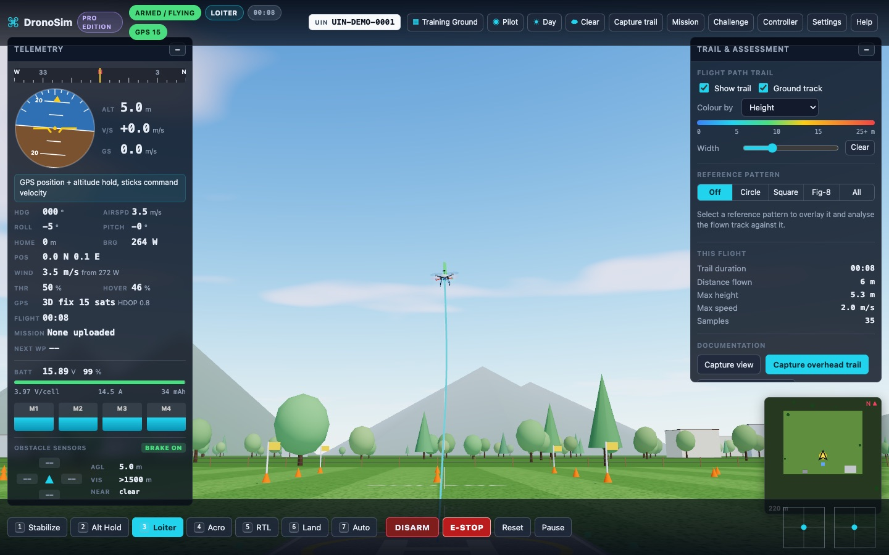
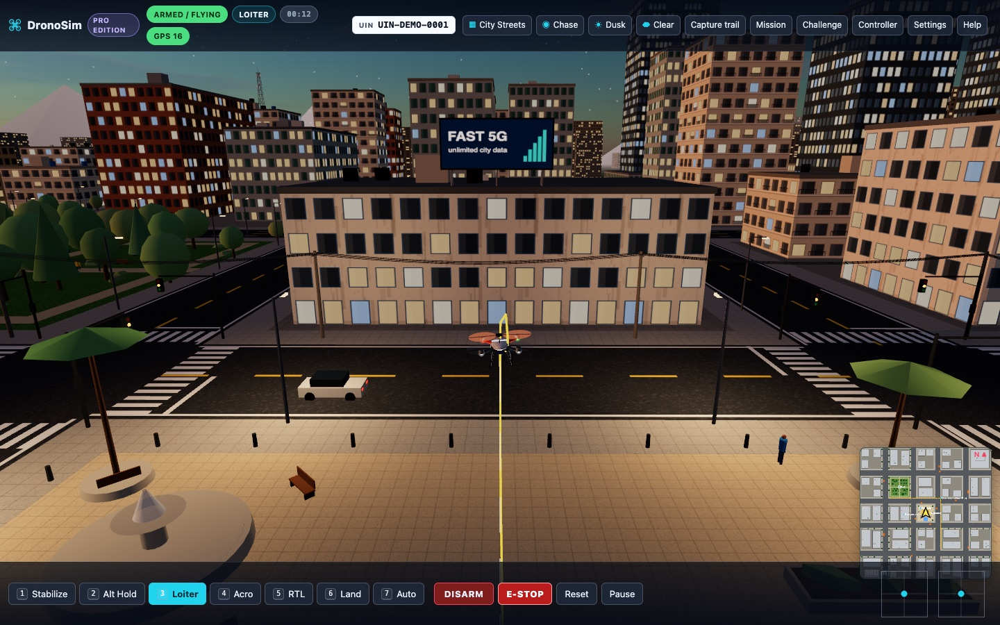
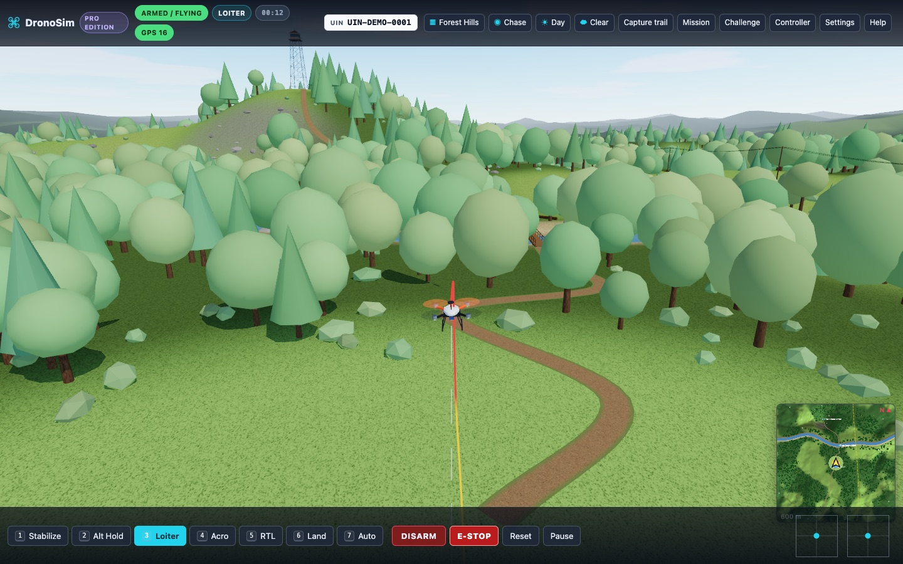
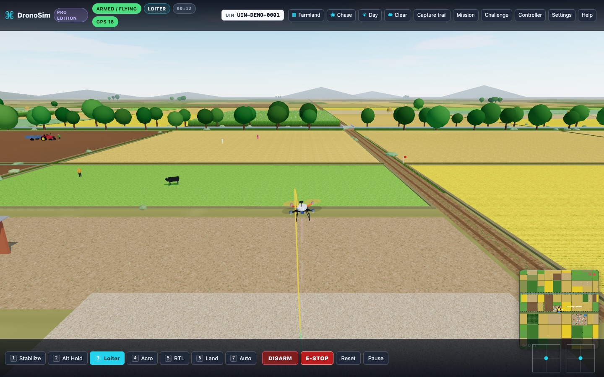
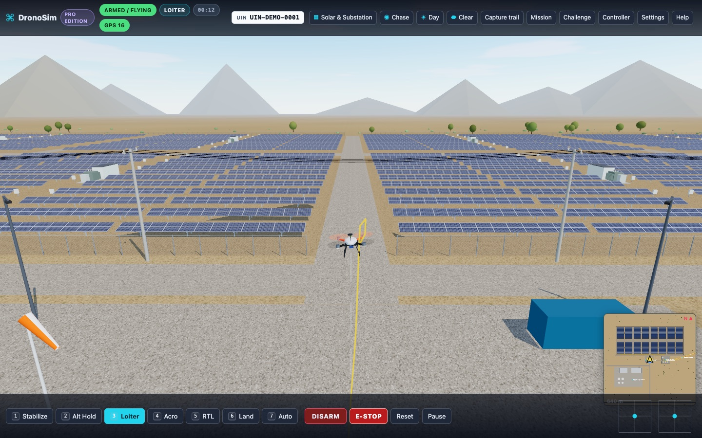
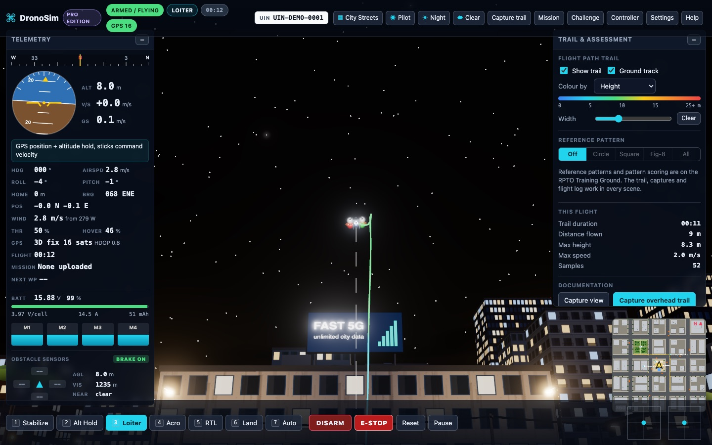

# DronoSim

**An open-source quadcopter simulator that runs in the browser: for training drone pilots, and for training and evaluating AI agents.**

[](https://github.com/nishantsirohi23/dronosim/actions/workflows/ci.yml)
[](LICENSE)

**[Try it in your browser](https://nishantsirohi23.github.io/dronosim/)** · [Agent API](docs/AGENT_API.md) · [Contributing](CONTRIBUTING.md)



| | | |
| --- | --- | --- |
|  |  |  |
| City Streets at dusk | Forest Hills | Farmland |
|  |  | |
| Solar & Substation | Night flying | |

DronoSim models a 450-class quadcopter with rigid-body physics and an ArduPilot-style cascaded PID flight controller. It covers flight modes, failsafes, wind, battery, five environments, obstacle sensors, a thermal payload camera and assessment tools. It runs offline in any WebGL 2 browser, needs no install, and the same simulation core is available headless to Node.js and Python agents.

## Who it is for

- **Drone pilot training** (RPTO / DGCA-style syllabi):
  - line-of-sight flying from a pilot station, and day, dusk and night operations;
  - RTL and failsafe behaviour;
  - circle, square and figure-of-eight patterns with automatic scoring;
  - assessment screenshots with the registration number, trainee and instructor;
  - USB RC transmitter support.
- **AI and robotics research:**
  - a Gymnasium-style environment with hover, waypoint, pattern and landing tasks, at two control levels (pilot sticks through the flight controller, or raw motor commands);
  - seeded and fully reproducible episodes, domain randomisation, and obstacle-rich scenes;
  - tens of thousands of steps per second on one CPU core;
  - a browser API that returns rendered frames for vision and computer-use agents.

## Quick start

**In the browser:** open the [live demo](https://nishantsirohi23.github.io/dronosim/), or run it locally:

```bash
git clone https://github.com/nishantsirohi23/dronosim.git
cd dronosim
npm install
npm start
```

Open http://localhost:5173.

Then fly:
1. Wait about 4 seconds for "GPS 3D fix".
2. Press `3` (Loiter), then `Enter` to arm.
3. Hold `W` to climb, then press `E` to hold the height.
4. Fly with the arrow keys and turn with `A`/`D`. Press `5` to return home and `H` for all controls.

**As an AI environment, in Node.js:**

```js
import { DroneEnv } from './src/agent/env.js';

const env = await DroneEnv.create({ task: 'waypoints', control: 'sticks', flightMode: 'LOITER', scene: 'city' });
let { obs } = env.reset(42);
const { obs: next, reward, terminated, truncated, info } = env.step([0, 0, 0.5, 0]); // throttle, yaw, pitch, roll
```

**In Python (Gymnasium):**

```bash
pip install -e python/
```

```python
import gymnasium as gym
import dronosim_gym

env = gym.make("DronoSim-Waypoints-v0", flight_mode="LOITER")
obs, info = env.reset(seed=0)
obs, reward, terminated, truncated, info = env.step(env.action_space.sample())
```

The full reference is in [docs/AGENT_API.md](docs/AGENT_API.md).

## For AI agents

| | |
| --- | --- |
| **Tasks** | `hover`, `waypoints`, `pattern` (circle / square / figure-of-eight, scored 0-100), `land`, and `free` (bring your own reward) |
| **Control** | `sticks`: the agent is the pilot, in Stabilize, Alt Hold, Loiter (velocity commands) or Acro (rates). `motors`: four raw motor commands with no flight controller |
| **Observation** | 25 floats: target offset, velocity, attitude quaternion, body rates, height above home and ground, battery, five obstacle-sensor distances, motor outputs |
| **Scenes** | Open ground (fastest), training ground, city with moving traffic, hilly forest, farmland, solar farm and substation |
| **Physics** | 400 Hz rigid body with motor lag, drag, ground effect, turbulence, gusts and battery sag. Crashes on hard impact, tip-over, or hitting buildings, trees, poles, wires or water |
| **Reproducibility** | One seed controls everything, including wind gusts and traffic. Gymnasium's `check_env` passes |
| **Speed** | ~120,000-150,000 steps/s on open ground, ~15,000 in the city (one core, Apple M4 Max) |
| **Interfaces** | Node.js (`DroneEnv`), Python Gymnasium (`dronosim_gym`), a JSON-lines server for any language, and `window.DronoSim` in the browser for vision and computer-use agents |

Baselines from `npm run benchmark` (20 episodes each, randomised wind and mass):

| Task | Random policy: success | Scripted Loiter pilot: success | Scripted pilot: return |
| --- | --- | --- | --- |
| waypoints | 0% | 100% | 77.9 |
| waypoints (city) | 0% | 100% | 75.4 |
| pattern (circle) | 0% | 100% | 57.0 |
| land | 0% | 100% | 26.4 |

There are no learned-agent baselines yet; PRs with results are welcome.

Ideas this setup supports:
- low-level attitude control from motor commands;
- navigation among obstacles using the sensor beams;
- robustness to wind and payload changes through randomisation;
- vision-based landing using browser frames;
- LLM agents that fly through `window.DronoSim` or the keyboard;
- comparing agents with human pilots on the same scored patterns.

See [limits of the simulation](docs/AGENT_API.md#limits-of-the-simulation-read-before-sim-to-real) before drawing sim-to-real conclusions.

## Features

### Flight model and flight controller
- **Physics:** a 450-class X quadcopter at 400 Hz. It models per-motor thrust with spool lag, reaction-torque yaw, quadratic and rotor drag against the air-relative velocity, ground effect, and ground contact with static friction.
- **Crash detection:** hard impacts, ground strikes, tip-overs, and collisions with buildings, trees, masts and power-line wires.
- **Cascaded PID control:** position → velocity → lean angle → body rate → motor mixer. It has anti-windup, roll/pitch-priority mixing, angle boost and hover-throttle learning, and the gains can be tuned in Settings.
- **Flight modes:** Stabilize, Alt Hold, Loiter, Acro, RTL, Land and Auto (waypoint missions).
- **Safety:**
  - pre-arm checks, plus stick and switch arming;
  - disarming in flight is refused (an emergency stop is available instead), and the drone auto-disarms after landing;
  - failsafes for low and critical battery, controller loss and geofence breach.
- **Realistic RTL:** climb to the RTL height, fly home with a deceleration profile, loiter over home restoring the take-off heading, then a two-stage descent and auto-disarm.
- **Wind and battery:** wind with a height profile, turbulence, gusts and a windsock. The 4S LiPo has a discharge curve and voltage sag that reduces thrust.

### Scenes and environment
| Scene | What it trains |
| --- | --- |
| **RPTO Training Ground** | Painted circle, square and figure-of-eight patterns, plus the structured challenge |
| **City Streets** | Tight urban flying among about 100 buildings, left-hand traffic, street lights and low cables |
| **Forest Hills** | Hilly terrain, dense forest, a river, a lookout tower, and a missing-person search with the thermal camera |
| **Farmland** | Crop fields, a village, an irrigation canal, a water tower and 11 kV lines (agricultural drone work) |
| **Solar & Substation** | Solar rows, a substation and 132 kV towers, with a hidden panel hot-spot to find in thermal |

The environment adds:
- a physically based sky with moving clouds;
- day, dusk and night, with street lights, lit windows and drone nav lights;
- clear, overcast, fog and rain weather;
- trees that sway in the wind;
- Low, Medium and High graphics quality for anything from office PCs to gaming GPUs.

### Sensors and payload
- **Obstacle sensors:** front, back, left and right beams plus a downward rangefinder. In Loiter the drone brakes automatically; in other modes the sensors only warn, and a proximity beeper sounds.
- **Payload camera:** a stabilised gimbal camera shown picture-in-picture, with visible, thermal and night-vision modes.
- **Minimap and sound:** a minimap with moving traffic and wires, and motor sound that follows each motor's output.

### Training and assessment
- **Flight path trail:** coloured by height, speed or mode, with a ground track and an overhead analysis view with grid, scale bar and north arrow.
- **Live pattern analysis:** track RMS error, maximum deviation, height stability, coverage and a 0-100 score.
- **Records:** assessment captures (PNG with UIN, trainee, instructor and statistics) and a 10 Hz CSV flight log.
- **Basic Proficiency Challenge:** six scored stages with a pass mark.
- **Mission planner** for AUTO missions:
  - waypoints, templates and survey grids;
  - planning checks for the fence, obstacles, wires and terrain;
  - a 3D mission path in the scene.
- **Controllers:** RC transmitters in USB joystick mode and gamepads, with a calibration wizard and switch mapping.
- **VR:** WebXR VR from the pilot station when a headset is available.
- **Desktop app:** Windows and macOS installers (Electron), for fully offline classroom use.

## Keyboard (Mode 2)

| Key | Action | Key | Action |
| --- | --- | --- | --- |
| W / S | Throttle up / down (Shift = faster) | 1-7 | Stabilize, Alt Hold, Loiter, Acro, RTL, Land, Auto |
| A / D | Yaw left / right | Enter | Arm / disarm |
| Arrows | Pitch and roll | X X | Emergency motor stop |
| E / Q | Throttle 50% / zero | R | Reset on the pad |
| C / V | Cycle views / overhead view | L | Choose scene |
| N / J | Time of day / weather | G | Payload camera mode |
| T / Y | Clear / show trail | [ ] - = | Payload tilt and zoom |
| P / Shift+P | Capture view / trail | B | Obstacle braking |
| M | Mission planner | K | Sound |
| O | Pattern overlay | H | Help |

## Builds and editions

`npm run build` writes three self-contained offline builds. Each one can be opened directly from disk (`index.html`) or served by any static web host:

| Folder | Edition | Contents |
| --- | --- | --- |
| `dist-pro/` | Full | All five scenes (what `npm start` and the live demo serve) |
| `dist/` | Base | Training ground only; other scenes appear as locked |
| `dist-demo/` | Demo | Training ground with a fixed 25 m / 60 m geofence |

Which scenes each edition gets is set in `SCENE_ACCESS` in `src/config.js`.

The desktop installers come from `npm run package`, `npm run package:pro` and `npm run package:demo`, which write to `release/`. Without code-signing certificates, Windows SmartScreen and macOS Gatekeeper warn on first launch.

## Project layout

```
src/
  physics/     rigid body, PID, wind, battery
  fc/          flight controller (modes, arming, failsafes, RTL, AUTO, mixer), missions
  world/       scenes/ (one module per scene + shared builders), atmosphere, cameras, trail, drone model
  sensors/     obstacle sensors, gimbal / thermal camera
  agent/       DroneEnv (headless), JSON-lines server, browser API, reference policies
  assess/      pattern analysis, challenge, assessment captures
  ui/ fx/ audio/ input/
python/        dronosim_gym (Gymnasium wrapper) and tests
examples/      node/ and python/ agent examples, benchmark
test/          headless tests: flight, failsafes, missions, sensors, agent API
docs/          AGENT_API.md, images
tools/         scene viewer for scene development
electron/      desktop shell; package.mjs builds installers
```

## Development

```bash
npm test           # 49 headless tests
npm run benchmark  # random vs scripted pilot, steps/s
pytest python/tests
```

See [CONTRIBUTING.md](CONTRIBUTING.md), including how to add a scene.

## Status and limits

- **Not certified.** DronoSim is a training and research tool and is not approved by DGCA or any other regulator. Do not describe it as approved, and do not use it as a substitute for regulated training hours unless an authority has accepted it.
- **Simplified physics.** See [limits of the simulation](docs/AGENT_API.md#limits-of-the-simulation-read-before-sim-to-real).
- **Hardware not yet tested.**
  - USB controller profiles in `src/config.js` are marked `validated: false` until they are tested on real hardware.
  - VR has not been tried with a headset.

## Citation

If you use DronoSim in research, please cite it using [CITATION.cff](CITATION.cff) (GitHub's "Cite this repository" button).

## License

[MIT](LICENSE) © 2026 Nishant Sirohi and DronoSim contributors. Built with [three.js](https://threejs.org) (MIT). The flight-mode behaviour is modelled on publicly documented ArduPilot / ArduCopter behaviour; DronoSim is not affiliated with ArduPilot.
